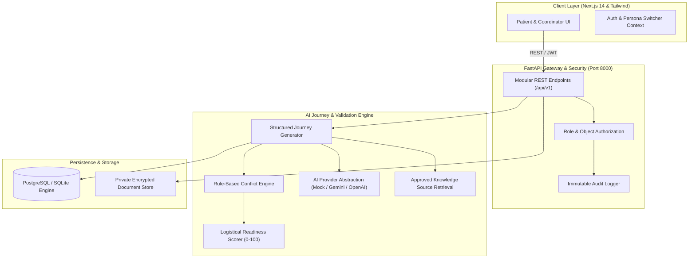

# MediGlobe AI — System Architecture

## 1. Executive Summary

MediGlobe AI is a modern full-stack medical travel coordination and logistics decision-support platform. Rather than serving as a passive directory, MediGlobe AI features an **AI Medical Journey Intelligence Engine** combined with a **Deterministic Rule-Based Conflict Engine** that continuously validates patient itineraries, identifies schedule overlaps, highlights cost quotation gaps, and tracks administrative readiness.

---

## 2. Architecture & Pipeline Diagram

---

## 3. The AI Medical Journey Pipeline

The journey planning pipeline strictly separates generative AI from deterministic safety and financial rules:

1. **Patient Preferences Input**: Collects residence country, treatment category, budget range, currency, language, and flexibility. Medical history is deliberately not demanded to avoid premature diagnostic assumptions.
2. **Hospital Database Search**: Queries verified hospital registry based on treatment categories and geographic preferences.
3. **Approved Knowledge Retrieval (RAG)**: Retrieves grounded immigration visa requirements (e.g. Thailand MT Visa), clinical travel stabilization guidelines (e.g. JCI 7-10 day recovery criteria), and pricing guidelines.
4. **Structured Journey Generation**: Generates 7 standard journey stages with assigned roles, dependencies, priorities, and source references.
5. **Deterministic Rule-Based Conflict Engine**: Validates dates and costs through mathematical logic (detecting transfer overlaps, lodging expirations before follow-up visits, missing cost categories).
6. **Transparent Journey Readiness Scoring**: Evaluates 5 administrative logistical dimensions on a 100-point scale.
7. **Database Persistence**: Stores Journey, Stages, Tasks, Line Items, and Alerts atomically.
8. **Interactive Dashboard**: Patient and hospital liaisons manage, acknowledge, and resolve milestones.

---

## 4. AI Provider Abstraction

The backend implements `BaseAIProvider` with three swappable drivers:
* **`MockAIProvider`**: Default provider enabling 100% offline development, deterministic hackathon demonstrations, and automated test execution without API keys or token costs.
* **`GeminiProvider`**: Integrates with Google Gemini (`gemini-2.5-flash` or configurable model) with structured JSON enforcement and automatic fallback.
* **`OpenAIProvider`**: Integrates with OpenAI models via structured JSON response schemas.

---

## 5. Deterministic Conflict Engine vs Generative AI

To ensure medical and financial safety:
* **Detection is Deterministic**: Application code compares timestamps, dates, and category arrays. AI is never allowed to hallucinate bookings, fabricate dates, or perform floating-point arithmetic.
* **Explanation is AI-Powered**: The AI takes the verified detected discrepancies and explains them in simple, reassuring, and actionable plain language for the patient.

---

## 6. Database Model Schema (20 Tables)

1. `users`: Authentication credentials, roles (`patient`, `hospital_admin`, `platform_admin`), hospital affiliations.
2. `patient_preferences`: Residence country, destinations, budget parameters, accessibility requirements.
3. `hospitals`: Name, location, verified credentials status, rating, multilingual support.
4. `hospital_services`: Categories, clinical services, active status.
5. `hospital_credentials`: Accreditation titles, issuers, verification status, evidence URLs.
6. `treatment_estimates`: Base, min, and max costs, package inclusions, and package exclusions.
7. `estimate_line_items`: Categorized costs (procedure, diagnostics, consultation, lodging, transport).
8. `journeys`: Master travel records, departure/return dates, readiness score.
9. `journey_stages`: 7 chronological milestones per journey.
10. `journey_tasks`: Action items, responsible parties, priority, dependencies.
11. `appointments`: In-person consults, surgical procedures, follow-ups, teleconsults.
12. `travel_arrangements`: Flights, airport transfers, hotel lodging, visa processing.
13. `documents`: Private file records, categories, AI metadata summaries.
14. `document_permissions`: Time-limited, revocable hospital sharing grants.
15. `consents`: Explicit patient consents for data processing, AI analysis, and provider sharing.
16. `knowledge_sources`: Grounding RAG corpus of verified visa and clinical guidelines.
17. `ai_recommendations`: Audit record of generated itineraries.
18. `journey_alerts`: Specific conflict alerts generated by deterministic rules.
19. `notifications`: In-app user notifications.
20. `audit_logs`: Immutable trail of authentication, verification, and file events.
